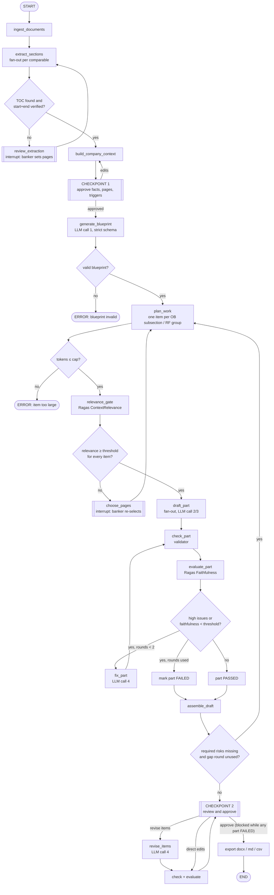

# IPO Drafting Assistant → LangGraph Agent: Conversion Plan

Status (2026-11-24): **steps 0-4 done** on branch `langgraph` (not committed).
- Data and cache folders can be set with `IPO_DATA_DIR` / `IPO_CACHE_DIR`.
- New files: `requirements-agent.txt` (pins `ragas>=0.4.4,<0.5`, which pulls `openai` 3.3), `.env.example`, and `agent/config.py` (no defaults; errors name the missing variable).
- Tests: 27 new tests in `tests_agent/`; the old suite gives 110 passed / 2 skipped on 3.8, 3.10 and 3.11.
- Local venvs: `.venv311` (agent), `.venv38` (VDI check).

**Step 1 done** (2026-11-24, not committed):
- `agent/telemetry.py`: OTLP/HTTP traces to Phoenix (`authorization: Bearer <PHOENIX_API_KEY>`, same as Phoenix's own client),
  the §8.1 metrics, auto-instrumentation (LangChain/LangGraph, OpenAI, httpx, sqlite3, logging), and a content guard
  (instrumentors hide inputs/outputs/invocation parameters, plus an exporter that strips any content attribute left).
- `python -m agent.telemetry --check` sends one span and says whether it was accepted.
- Two new required settings: `DEPLOYMENT_ENVIRONMENT`, `OTEL_METRICS_EXPORTER` (otlp|none). A Phoenix Cloud endpoint without `PHOENIX_API_KEY` is a config error.
- Verified: local open-source Phoenix 22.0.1 (run with `pip install arize-phoenix` + `phoenix serve`, Docker wasn't running) received the
  `telemetry.check` span in project `ipo-agent`. Phoenix Cloud not yet checked (needs your space URL and API key).
- Tests: 22 new in `tests_agent/test_telemetry.py`, 5 new config cases (54 agent tests total); old suite 110 passed / 2 skipped on 3.8 and 3.11.

**Step 2 done** (2026-11-24, not committed):
- `agent/llm/schemas.py`: strict `BlueprintOut` (every field required, no extra keys; checked against the OpenAI SDK's strict schema).
  Empty subsections/themes, duplicate IDs or unlisted groups raise `BlueprintInvalid`. Round trip to `core.blueprint.Blueprint` tested.
- `agent/pack_text.py`: packs as labelled text (`[D1 p.45]` + page text; comparable pages marked STYLE ONLY and refused as sources).
  One pack per OB subsection, per RF group (numbered RF01-39 / RF40-69 / RF70-99, renumbered at assembly) and per revision.
  A subsection with no selected pages raises `NoPagesSelected` (for the banker); over `MAX_INPUT_TOKENS` raises `ItemTooLarge`.
- `agent/llm/prompts.py`: system prompts are the four presets with exact, checked text edits (no TASK_ID line, files as text,
  IPO-01 returns the schema). A preset wording change makes it error, not send a half-edited prompt.
- `agent/llm/client.py`: `ChatOpenAI` per call type, 2 SDK retries (transient only), `call_blueprint` (strict JSON) and `call_text`.
  Tokens are recorded on the trace; cost is left empty until prices are configured (step 6), never guessed.
- New required settings: `OPENAI_TOKENIZER` (tiktoken has no mapping for `gpt-6-luna`; `o200k_base` assumed, to be compared with
  OpenAI's reported tokens in step 6), `OPENAI_TIMEOUT_S`, `OPENAI_TEMPERATURE` (number or `omit`).
- Real sizes on the e2e test deal (SBI AR + C1 + C2), o200k_base: blueprint 130,451 tokens (6 company + 115 comparable pages);
  OB items 59-63k each (9-10 company + 50 comparable pages); RF Internal 98,070, External 81,504, Offer 73,058. All under the 200k cap.
  Comparable style pages are about 3/4 of every OB item.
- Tests: 33 in `tests_agent/test_llm.py` with a test-only mock model (`tests_agent/mock_llm.py`); 95 agent tests in all;
  old suite 110 passed / 2 skipped on 3.8 and 3.11.
- Note: the e2e deal folder no longer holds its uploaded PDFs; the sizes above came from a scratch copy pointing at the same files in Downloads.

**Step 3 done** (2026-11-24, not committed):
- `agent/tools.py`: 17 tools (§9) as plain functions plus LangChain `StructuredTool`s in `TOOLS`. Each returns a short summary;
  unknown deals, documents, pages or items raise `ToolError` with a plain message. `extract_sections` marks a section `accepted`
  only when found via the TOC with start and end verified; anything else sets `needs_banker`.
- `score_item` (Ragas) is not in yet: it comes with `agent/evals.py` in step 5.
- Tests: 11 fast tests on a temp deal + 1 real-document test (`IPO_SAMPLE_AR` + `IPO_SAMPLE_DRHP`, 32 s) that runs every tool.
  Real results: ICICI Pru AMC DRHP OB p160-184 and RF p35-65, C1 OB p166-190 and RF p21-54, all via TOC with both ends verified;
  206 printed pages; consolidated PAT ₹2,54,015.32 lakhs cited [D1 p.145]; 11 risk triggers, 6 required.
  Agent suite 106 passed / 1 skipped (the real-document test when env vars are unset); old suite 110 passed / 2 skipped on 3.8 and 3.11.

**Step 4 done** (2026-11-24, not committed): graph part A.
- Files: `agent/state.py` (state, reducers, banker reply models), `agent/routing.py`, `agent/nodes/facts.py`, `agent/nodes/common.py`
  (span per node; any error stops the run with `status=error` and a message naming the step), `agent/graph.py`
  (`build_graph`, `deal_graph` with `SqliteSaver` in `data/deals/<deal>/runs.sqlite`, `start` / `resume` / `pending`).
- Flow: ingest -> one extract task per comparable (parallel) -> join -> review_extraction (banker: confirm / set_range / drop)
  -> check_style_coverage (each section needs >= 1 usable comparable, else error) -> build_company_context -> checkpoint 1 -> facts_approved -> END.
- Differences from §5.1: (1) after banker edits at checkpoint 1 the context is NOT rebuilt (that would overwrite the edits);
  the edits are applied and checkpoint 1 is shown again. (2) Review decisions are applied without re-extracting, for the same reason.
  (3) Approval with edits in the same reply is refused: edits first, look, then approve. Approval is also refused while blockers
  exist (no figures, unknown basis, no Overview pages). (4) A decision about a section that isn't under review, or "confirm" for a
  section that was not found, is not applied and is reported back as a notice at the next pause.
- Telemetry fixes found by looking at the real trace in Phoenix: LangGraph signals a pause with an exception that carries the
  checkpoint payload (all figures). It was being recorded as an error with that text. Now a pause is marked `paused`, never an error,
  and the exporter strips the payload of any pause exception recorded by other instrumentation. Each banker action
  (`action.start`, `action.resume`) is a parent span, so a run's steps are one trace.
- Verified on real documents (SBI AR + ICICI Pru AMC DRHP + C1), traced to local Phoenix: pauses at checkpoint 1 with consolidated
  PAT ₹2,54,015.32 lakhs [D1 p.145], 18 figures, 11 triggers; all 4 comparable sections accepted via the TOC. Phoenix holds no
  document figures or text, and no error spans.
- Timing (laptop): extraction with a cold text cache is ~61 s for the 439-page DRHP alone (21 s when cached). Two cold comparables
  in parallel took ~225 s each (threads don't help this CPU-bound work). **Step 10 risk:** Render free has 0.1 CPU and its disk is
  wiped on sleep, so every first run there reads cold; expect many minutes. Options to weigh then: run extraction in a process pool,
  extract comparables once and keep the result with the deal backup, or a paid instance.
- Tests: `tests_agent/test_graph_a.py` (19: one per routing condition, graph paths with InMemorySaver, persistence across reopen,
  one-trace-and-no-content check with full auto-instrumentation, real-document run). 127 agent tests pass (2 real-document tests skip
  without env vars; both pass with them); old suite 110 passed / 2 skipped on 3.8 and 3.11.

**Step 5 done** (2026-11-24, not committed): graph part B.
- Files: `agent/nodes/drafting.py` (blueprint, plan, relevance gate, choose_pages, the per-item draft/check/evaluate/fix/finish
  nodes, assemble), `agent/evals.py` (Ragas faithfulness + context relevance; `RAGAS_DO_NOT_TRACK=true` is forced, so Ragas sends
  no usage data), `agent/deps.py` (settings, telemetry, chat models, scorer in one object; tests pass their own), `agent/graph.py`
  (part B wired in; each work item runs as a subgraph `part`, all items in parallel).
- Flow: facts_approved -> generate_blueprint (strict schema; unusable = error, no default) -> plan_work (one item per Our Business
  subsection, one per Risk Factors group; an item over MAX_INPUT_TOKENS stops the run naming it) -> relevance_gate (pages of each
  item vs. its brief; statement pages left out of the score) -> [choose_pages: banker picks pages, drafts a low-relevance item
  anyway, or leaves a subsection out] -> parts in parallel -> assemble_draft (OB in blueprint order; RF numbered RF01, RF02, ...)
  -> one gap round for missing subsections / required risks -> drafted -> END. Checkpoint 2 (banker review of the draft) is step 7.
- Inside a part: draft -> check (existing validator: numbers, citations, comparable facts) -> faithfulness -> PASSED, or fix
  (IPO-04 rules, one call per failing item, told the unsupported claims) and check again. After MAX_FIX_ROUNDS (2) fixes it is
  FAILED: kept, clearly marked, every round saved in `runs/<run>/parts/`, and it blocks export. An API error in any part stops
  the run; nothing is assembled and no other model is tried.
- Fix found while testing: LangGraph reads a reply of `{}` as "answer no pause" and silently asks again. `resume` now addresses
  the pause by its id, so an empty or invalid reply is rejected with a message and nothing is saved.
- Real deal (SBI AR + ICICI Pru AMC DRHP, mock blueprint with 4 subsections, no API calls): 6 items planned; sizes
  Overview 32,737 tokens (10 pages), Strengths 33,059, Strategies 33,996, Internal Risks 59,248 (28 pages), External 40,617,
  Offer 38,067, all under the 200,000 cap. "Description of our Business" has no mapped pages, so it goes to the banker.
- Not yet run against the live OpenAI API or real Ragas (needs the key); that is the first thing to do in step 6/7.
- Tests: `tests_agent/test_graph_b.py` (12: OB + RF drafts produced; fix loop stops at 2 and FAILED blocks export; a working fix
  passes after 1 round; comparable cited as a source is fixed; invalid blueprint; item too large; API error; no pages; low
  relevance + empty reply rejected; gap round fills a missing required risk; still missing blocks export; Ragas tracking off).
  Agent suite 141 passed (with real-document env vars set); old suite 112 passed on 3.8 and 3.11.

**Step 6 in progress** (2026-11-25, not committed): everything for the live run is built; **the live run itself is waiting for an
OpenAI API key** (none is set on this machine).
- Cost: optional `OPENAI_PRICES` in `.env` (USD per 1M tokens, copied from OpenAI's pricing page). A model with no price shows
  "price not set"; a cost is never guessed.
- Call ledger `agent/usage.py`: every model call (blueprint, draft, fix, and each request the Ragas judge makes) is written to
  `data/deals/<deal>/runs/<run>/calls.jsonl` with tokens, seconds and cost. Counts only, no text. Judge tokens are read from the
  OpenAI responses, because Ragas doesn't return them. Each part also keeps its faithfulness per round, to tune the threshold.
- Report `agent/report.py`: per part (status, fix rounds, faithfulness per round, relevance, issues, tokens, cost, time), per call
  type, totals, and a check of our token count against what OpenAI reports. `compare` puts runs side by side.
- Script `agent/live_run.py` (needs `--public-documents`; answers pauses only as its flags say, otherwise stops and saves the run):
  ```
  python -m agent.live_run run --public-documents --company <SBI AR> --comparable <ICICI Pru DRHP> --run-id luna-1 --approve-facts --exclude-unmapped --proceed-low-relevance
  python -m agent.live_run run --public-documents --deal <deal-id> --run-id sol-1 --draft-model <Sol model id> --approve-facts --exclude-unmapped --proceed-low-relevance
  python -m agent.live_run compare --deal <deal-id> luna-1 sol-1 --out luna_vs_sol.md
  ```
  Note: the Sol run regenerates the blueprint (same Luna model, temperature 0), so its subsections may differ slightly; the report
  lists them per part.
- Tests: `tests_agent/test_step6.py` (8, mock: prices, judge token hook, ledger, report, comparison, the script end to end) and
  `tests_agent/test_live.py` (2, only with `IPO_LIVE_LLM=1`: the judge scores a correct paragraph >= FAITHFULNESS_MIN and an
  invented one < 0.5; a full live run produces cited drafts with no comparable citations). Agent suite 149 passed / 2 skipped;
  old suite 112 passed on 3.8 and 3.11.
- Still to do once the key is set: run Luna, look at the traces in Phoenix, tune FAITHFULNESS_MIN / RELEVANCE_MIN from the
  per-round scores, run Sol, and write the comparison table here. (Skipped for now at the user's request; step 7 done first.)

**Step 7 done** (2026-11-25, not committed): checkpoint 2, the revise / edit loop, and export.
- Files: `agent/nodes/review.py` (checkpoint_review, apply_review, export), reply schema `ReviewReply` in `agent/state.py`,
  routing `route_after_review` / `route_after_apply`. `core/workspace.py`: export takes an optional note (3.8-safe); the
  Stylus pages keep their old wording, agent exports say "agent run <run>, drafting model <model>".
- Flow: drafted -> checkpoint_review (pause; shows every item with its text, status, faithfulness, issues, unsupported claims,
  versions, plus missing subsections / required risks and the blockers) -> changes -> apply_review -> checkpoint_review ...
  -> approve -> export (Word + Markdown per section and `checks.csv`, in `exports/<run>/`) -> END, status `done`.
- Banker changes: revise (model rewrites the item under IPO-04 rules with the banker's instructions, the item's high issues and
  the unsupported claims), edit, restore an earlier version, recheck, add a risk (risks renumbered RF01...), write a missing
  subsection, leave out a missing subsection, mark a required risk not applicable (reason required; kept in the log and in
  `checks.csv`). Every changed item is checked and scored on its own and gets its own PASSED / FAILED; old text is kept as a version.
- Rules: approve must come alone (changes first, look, then approve). Approve is refused while any item is FAILED or anything
  required is missing; the run pauses again with the reason. A revise reply without the item leaves the text unchanged and says so.
- Stricter than before (both at drafting and at review): an Our Business item with no company citation is a high issue,
  because every fact needs a `[D… p.N]` citation.
- A live run (`agent.live_run`) now ends at checkpoint 2 with the draft ready, and writes its report there.
- Tests: `tests_agent/test_graph_c.py` (11: approve exports a readable Word file; approve refused while FAILED, then a revise
  fixes it and export works; edit + restore; comparable citation in an edit fails; invalid / unknown changes; revise reply
  without the item; missing required risk added; marked not applicable with a reason; missing subsection written by the banker;
  left out; no draft text in traces). Agent suite 160 passed / 2 skipped (live only); old suite 112 passed on 3.8 and 3.11.

**Step 8 done** (2026-11-25, not committed): Streamlit page 6 and deal backup / restore.
- `pages/6_Agent_Run.py`: start a run (live progress per step), pick a saved run, and answer each pause with a form:
  extraction review, checkpoint 1 (edit figures, untick risk triggers, choose or add pages), choose pages, checkpoint 2
  (per item: status, scores, issues, edit text, ask the model to revise, restore a version, re-check; write or leave out a missing
  subsection; add a risk; mark a required risk not applicable with a reason), then downloads. "Approve" is stopped on the page
  if anything was changed but not applied. A run cut off mid-way (page closed) shows **Continue run** and carries on from its last
  saved step. Run log and the calls / tokens / cost table are on the page.
- Access: if `APP_PASSWORD` is set the page asks for it; if `DEPLOYMENT_ENVIRONMENT` is not `local` and no password is set, the page
  refuses to run. On `render` it shows the "deals are deleted when the app sleeps" banner. On Python 3.8 it only shows
  "needs Python 3.11" (pages 1-5 unchanged). Applying the password to pages 1-5 too is left for step 9 (deployment).
- `agent/backup.py`: backup = one .zip of the deal folder plus a consistent copy of `runs.sqlite`, with a SHA-256 per file in
  `manifest.json`. Restore checks the format, every checksum, and every path (no `..` or absolute paths) before writing; it
  writes to a staging folder first, so a bad file changes nothing; an existing deal is replaced only when asked. Stored file
  locations (documents, drafted parts, exports) are now relative to the deal folder or rewritten on restore, so a restored deal
  works in a different data folder.
- Bug found and fixed while testing the page: after applying changes, Streamlit kept showing what was typed before, so a second
  "Apply" could silently undo a revision. Forms now start fresh after every action.
- Checked in the browser on the real deal (SBI AR + ICICI Pru AMC DRHP, placeholder key since part A needs no API): checkpoint 1
  shows consolidated PAT 254015.32 / 207278.35 lakhs [D1 p.145] and the page lists; backup 17.9 MB. Restoring that backup into an
  empty data folder brings back the run, still waiting at checkpoint 1 with the same PAT.
- Tests: `tests_agent/test_ui_agent_page.py` (8, Streamlit AppTest with the mock model: both checkpoints and downloads; review
  changes then approve; approve with unapplied changes stopped; missing settings and password; shared deployment without a
  password refused; backup -> wipe -> restore -> resume -> export; backup contents; damaged / foreign / unsafe backups refused
  with nothing changed). Agent suite 168 passed / 2 skipped (live only); old suite 112 passed on 3.8 and 3.11.

**Step 9 done locally** (2026-11-25, not committed; CI has not run on GitHub yet because there is no remote).
- Password on every page: `core.ui.require_access()` runs right after `st.set_page_config` in `app.py` and pages 1-6
  (3.8-safe, constant-time compare). No `APP_PASSWORD` on a shared deployment (`DEPLOYMENT_ENVIRONMENT` not `local`) = the app
  refuses to run. Tests: `tests/test_access.py` (4, also on 3.8).
- `Dockerfile`: python:3.11-slim, non-root user (uid 10001), data in `/tmp/ipo/data`, tokenizer file baked into the image so token
  counting needs no download. `.dockerignore` keeps deal data, `.env`, venvs, tests, decks and PDFs out of the image.
- `requirements-lock.txt`: exact versions from the tested 3.11 venv (144 packages). Needed because a fresh install from the
  ranged lists made pip backtrack through openai versions for a very long time.
- `render.yaml`: one free Docker web service, deploys `main` only after CI passes (`autoDeployTrigger: checksPass`, checked in
  Render's docs), health check `/_stcore/health`. Password, OpenAI key, prices and Phoenix settings are `sync: false` (typed into
  Render, never committed).
- `.github/workflows/ci.yml`: old app on Python 3.8 (VDI versions), app + agent on 3.11, then build the image, start it with
  Render-like settings and a placeholder key, wait for the health endpoint, check the non-root user and that no data / `.env` /
  tests are inside, and run the mock-deal tests inside the image. No secrets used.
- Checked locally with the same steps: health "ok"; uid 10001; tokenizer works with no network; image 1,035 MB; 55 MiB memory at
  idle; 19 mock tests pass inside the image; in the browser the container shows only the password box until the password is given.
- Suites: 3.11 `tests` + `tests_agent` 280 passed / 6 skipped; 3.8 `tests` 114 passed / 2 skipped.
- Git: the repository used to be the whole Desktop folder (personal files included). `IPO_DRAFT` is now its own repository
  (branch `langgraph`, committed 2026-11-25, no remote yet). It would hold 92 files: code, settings, tests and Markdown docs; a scan found no
  names, emails, local paths or keys. Deal data, `.env`, PDFs, decks, Word files and Stylus reply samples are ignored.
Reads with: `CLAUDE.md` (constraints), `PLAN.md` (original design), the "Target state" slide in both decks.

Decisions so far:
- LLM: **OpenAI**, via the OpenAI API (see §6).
- Observability: **OpenTelemetry**, sent to open-source tools that we run ourselves (see §8).
- Quality scoring: **Ragas** (faithfulness, context relevance), run with the same OpenAI model (see §7).
- **Correct or error, never a guess.** No automatic fallbacks, no hard-coded stand-in values (see §2).

---

## 1. Goal in one paragraph

Turn the five-page Streamlit tool into a **LangGraph agent** that runs the deck's target-state flow:
upload docs → extract facts → **banker checkpoint 1 (approve facts)** → plan and split the work →
draft all parts in parallel → run checks and Ragas scores → fix flagged parts (loop) → assemble →
**banker checkpoint 2 (review and approve)** → export Word.
The agent runs inside the Streamlit app, in one Docker image that Render (free tier) builds from GitHub. Every step is traced with
OpenTelemetry so latency, tokens, cost, check results and Ragas scores can be seen per deal.

**What does not change:** the Python logic in `core/` (section extraction, printed pages, financials,
risk triggers, BM25, reply parsing, validator, Word export). It has no Streamlit dependency, so the agent
calls it as-is. The 110 existing tests stay green. The current Streamlit + Stylus workflow keeps working on the VDI.

---

## 2. Rule: correct answer or an error

The system must never fill a gap with a made-up or default value just to show something. If it can't
produce a verified result, it stops with a clear error or hands the decision to the banker.

| Place | What the old plan / app does | What the agent does instead |
|---|---|---|
| Blueprint | falls back to a hard-coded default blueprint when the LLM reply can't be read | **No default blueprint.** The blueprint comes from the LLM using OpenAI strict structured output, checked against the `Blueprint` schema. If the reply fails the schema or has 0 subsections, the run **errors**. |
| Blueprint parsing | tolerant parser repairs quotes, comments, "800-1000" → 900 | Not used in the agent. Strict JSON schema means `target_words` is an integer by contract. (The tolerant parser stays only for Stylus files in the Streamlit app.) |
| Section extraction | bookmarks / heading scan used when TOC fails | Accepted automatically **only** when found via the TOC **and** start and end are verified against bold capital headings. Anything else **stops for the banker** (interrupt). Nothing is accepted silently. |
| Financials | standalone used when consolidated is missing | The basis used (consolidated or standalone) and the cited page of every figure are shown at checkpoint 1. The banker approves them; nothing is assumed. |
| Page budget | packer drops low-priority pages to fit 90 pages / 9 MB | Not needed: `gpt-6-luna` takes 922k input tokens. **All banker-selected pages are sent.** If a call would exceed `MAX_INPUT_TOKENS`, the run **errors** and names the work item. Pages are never dropped quietly. |
| Checks after fixing | low-severity issues kept as flags; high issues accepted after the last round | A part with any **high** issue, or a faithfulness score below the threshold, after `MAX_FIX_ROUNDS` is marked **FAILED**. Export is **blocked** until the banker fixes or rewrites it. |
| Missing facts | — | The model writes `[TBD: …]` (preset rule). That's an honest gap, listed in GAPS, never a guessed number. |
| LLM / network errors | — | Retry only *transient* errors (HTTP 429/5xx, timeouts), 3 tries with backoff. After that the run status is `error` with the message. No switch to another model or provider. |
| Configuration | — | Required settings (`OPENAI_API_KEY`, model IDs, thresholds) have **no in-code defaults**. The service refuses to start if one is missing. |
| Test doubles | — | The mock LLM exists only in tests (injected by the test suite). It can't be selected in a deployed service. |

---

## 3. Facts that shape the design

| # | Fact | Consequence |
|---|---|---|
| 1 | **LangGraph needs Python ≥ 3.10.** The VDI has 3.8/3.9. | The agent (`agent/`, page 6) runs on Python 3.11 in Docker. `core/` stays 3.8-compatible. |
| 2 | **Render is an external cloud host, and the OpenAI API is an external service.** | Only public test documents (SBI Funds AR, the ICICI Pru AMC and C1 DRHPs) go to Render, OpenAI or Phoenix Cloud until compliance approves anything else. |
| 3 | **`gpt-6-luna` takes text and image input; PDF input isn't listed** on OpenAI's model page. | Packs go as labelled text (`[D1 p.45]` + the page's extracted text), the same text the validator checks numbers against. Stylus-style PDF packs are not used in the agent. |
| 4 | The Stylus 100-page / 10 MB limit doesn't apply to the API. | The page budget is replaced by a token cap per call (`MAX_INPUT_TOKENS`) that errors instead of trimming. |

---

## 4. Target folder layout

```
IPO_DRAFT/
  core/                      unchanged except: data/cache dirs read from env vars (step 0)
  agent/
    config.py                settings from env (pydantic-settings); missing required value = startup error
    state.py                 DealState (TypedDict) + reducers
    graph.py                 builds and compiles the main workflow -> `graph`
    routing.py               every conditional-edge function in one file (the "conditions")
    nodes/                   ingest, extract, review_extraction, context, checkpoint_facts, blueprint,
                             plan, relevance_gate, draft, check, evaluate, fix, assemble,
                             checkpoint_review, export
    tools.py                 @tool wrappers over core/
    llm/
      client.py              ChatOpenAI factory (one per call type, model from config)
      prompts.py             loads core/prompts/presets/*.md + builds the task sheet as text
      schemas.py             pydantic output models for strict structured output
    pack_text.py             labelled page text for a work item + token count (tiktoken)
    evals.py                 Ragas scorers (Faithfulness, ContextRelevance) + thresholds
    telemetry.py             OpenTelemetry setup: traces, metrics, logs; instrumentors
    pricing.py               $ per 1M tokens per model (config, from OpenAI's pricing page)
  pages/6_Agent_Run.py       Streamlit page that runs the agent and shows the checkpoints
  observability/
    otel-collector.yaml      collector pipelines (traces → Phoenix; metrics → Prometheus)
    prometheus.yml           scrape config
    grafana/                 provisioned datasource + "IPO Agent" dashboard JSON
    docker-compose.yml       app + collector + Phoenix + Prometheus + Grafana, for local runs
  tests_agent/               new tests (unit, routing, graph, evals, API, telemetry, docker smoke)
  langgraph.json             local LangGraph Studio debugging only
  requirements-agent.txt     langgraph, langchain-openai, openai, ragas, opentelemetry-*,
                             openinference-instrumentation-*, langgraph-checkpoint-sqlite, tiktoken
  Dockerfile, .dockerignore, render.yaml, .env.example
  .github/workflows/ci.yml   tests + docker build on every push
```

---

## 5. The graph

### 5.1 Flow diagram



`draft_part → check_part → evaluate_part → fix_part` runs as a **subgraph per work item** (fan-out with `Send`).
Each part loops on its own while the others carry on; results merge back through a reducer keyed by item ID.

### 5.2 State

Large things (page text, units, drafts) stay on disk in `data/deals/<deal>/` through `core/store.py`.
The state holds IDs, flags and scores, so checkpoints stay small.

```python
class DealState(TypedDict, total=False):
    deal_id: str
    run_id: str
    docs: List[dict]                        # DocumentMeta summaries (D1.., C1..)
    extraction_flags: List[dict]            # per (doc, section): method, start/end_verified, confidence
    facts_approved: bool
    work_items: List[dict]                  # {item_id, section, title, cites, input_tokens, relevance}
    parts: Annotated[List[dict], merge_by_item_id]   # text, issues, faithfulness, rounds, status PASSED/FAILED
    missing_required: List[str]
    gap_rounds: int
    review_decision: Optional[dict]
    exports: Dict[str, str]
    status: str                             # running | waiting_banker | error | done
    error: Optional[str]                    # set once; the run stops
    log: Annotated[List[str], operator.add] # audit trail shown to the banker
```

### 5.3 Nodes

| Node | Kind | Reuses from `core/` |
|---|---|---|
| `ingest_documents` | Python | `store.create_deal`, `store.add_document`, `pdf_reader.page_count` |
| `extract_sections` (per C doc) | Python | `section_extractor.extract_sections`, `add_subheadings`, `store.save_extraction` |
| `review_extraction` | **interrupt** | `section_extractor.manual_section` on resume |
| `build_company_context` | Python | `context.process` (units, indicators, triggers, BM25 mapping) |
| `checkpoint_facts` | **interrupt** | `context.update_figures`, `save_triggers`, `save_mapping` on resume |
| `generate_blueprint` | **LLM 1** | page choice of `packer.build_ipo01`, preset IPO-01 rules, `blueprint.Blueprint` as schema, `attach_map_keys` |
| `plan_work` | Python | blueprint + banker-approved mapping + triggers; `pack_text` builds each item's input and counts tokens |
| `relevance_gate` | **Ragas** | `ContextRelevance(user_input=item brief, retrieved_contexts=item pages)` |
| `choose_pages` | **interrupt** | `context.save_mapping` on resume |
| `draft_part` | **LLM 2 / 3** | preset IPO-02 / IPO-03 rules, task-sheet content, `replies.split_items` |
| `check_part` | Python | `validator.check_item`, `replies.check_citations` |
| `evaluate_part` | **Ragas** | `Faithfulness(response=item text, retrieved_contexts=cited page texts)` |
| `fix_part` / `revise_items` | **LLM 4** | preset IPO-04 rules + issue list / unsupported claims / banker instructions |
| `assemble_draft` | Python | `replies.Draft`, `save_draft`, `validator.uncovered_required` |
| `checkpoint_review` | **interrupt** | `workspace.save_item_edit`, `restore_version` on resume |
| `export` | Python | `workspace.section_docx`, `section_markdown`, check + score CSV |

### 5.4 Conditions (all in `agent/routing.py`)

| Where | Condition | Goes to |
|---|---|---|
| after `extract_sections` | method is `toc` **and** `start_verified` **and** `end_verified` for every OB/RF section | `build_company_context`; otherwise `review_extraction` |
| `checkpoint_facts` resume | `{"approved": false, "edits": …}` | apply edits → `build_company_context` → pause again |
| | `{"approved": true}` | `generate_blueprint` |
| after `generate_blueprint` | reply passes the schema **and** has ≥ 1 OB subsection **and** ≥ 1 RF theme | `plan_work`; otherwise **ERROR** (message shows the schema error) |
| after `plan_work` | any item's input > `MAX_INPUT_TOKENS` | **ERROR** naming the item; banker splits or deselects pages |
| after `relevance_gate` | every item's ContextRelevance ≥ `RELEVANCE_MIN` | fan-out to `draft_part`; otherwise `choose_pages` (interrupt, low items listed with scores) |
| after `evaluate_part` | no high issue **and** faithfulness ≥ `FAITHFULNESS_MIN` | part PASSED |
| | either fails and `rounds < MAX_FIX_ROUNDS` | `fix_part`, given the exact issues and the unsupported claims Ragas found |
| | either fails and rounds used up | part **FAILED** (kept, clearly marked, blocks export) |
| after `assemble_draft` | `uncovered_required` not empty or `missing_ids` not empty, and `gap_rounds < 1` | `plan_work` for the missing items only |
| | still missing after the gap round | listed at checkpoint 2 as blocking |
| `checkpoint_review` resume | `approve` with no FAILED part and no missing required risk | `export` |
| | `approve` while something blocks | rejected with the reason; pause again |
| | `revise` {id: instructions} / `edit` {id: text} | `revise_items` or save as new version → check + evaluate → pause again |
| any LLM / Ragas node | transient API error after 3 retries; non-transient error at once | **ERROR**, run status `error` |

Settings (all required in env, no in-code defaults; suggested starting values in `.env.example`):
`MAX_FIX_ROUNDS=2`, `MAX_GAP_ROUNDS=1`, `MAX_INPUT_TOKENS=200000`, `FAITHFULNESS_MIN=0.90`,
`RELEVANCE_MIN=0.50`, `MAX_CONCURRENCY=4`. The thresholds get tuned on the test deal in step 6.

---

## 6. LLM calls and model choice

All prompts reuse the four preset texts in `core/prompts/presets/` so the rules stay the same as in Stylus:
cite every fact `[D1 p.N]`, comparables are style only, `[TBD]` for gaps, fixed `### <ID> [Group] <Title>` output.
`temperature=0` wherever the model allows it, for repeatable output.

| # | Call | Output | Model setting |
|---|---|---|---|
| 1 | Style & blueprint (IPO-01 rules) | strict JSON → `Blueprint` | `OPENAI_MODEL_BLUEPRINT` |
| 2 | Draft one OB subsection (IPO-02 rules) | `### OB0x …` item, parsed by `split_items` | `OPENAI_MODEL_DRAFT` |
| 3 | Draft one RF group (IPO-03 rules) | `### RFxx [Group] …` items + `### GAPS` | `OPENAI_MODEL_DRAFT` |
| 4 | Fix / revise one item (IPO-04 rules) | one item | `OPENAI_MODEL_DRAFT` |
| 5 | Ragas judge (faithfulness claims, context relevance) | scores + unsupported claims | `OPENAI_MODEL_EVAL` |

There's deliberately **no LLM** in section extraction, financial figures, risk triggers or number checks. Those are exact and
tested, and an LLM would make them less reliable.

**Model recommendation.** OpenAI's model page confirms `gpt-6-luna` has structured outputs and a 922k-token input limit.
Prices below are from third-party trackers (Nov 2026); check OpenAI's pricing page before budgeting.

| Model | Price per 1M tokens (in / out) | Rough cost per deal* |
|---|---|---|
| GPT-6 Luna (`gpt-6-luna`) | $0.10 / $0.50 | ≈ $0.10 |
| GPT-6.1 Terra | $1 / $5 | ≈ $1 |
| GPT-6.1 Sol | $2 / $10 | ≈ $2 |

\*Estimate: about 15 drafting calls at 30k tokens in / 2k out, plus fixes and Ragas. It gets measured for real in step 6 through telemetry.

- **Start with `gpt-6-luna` for all calls**, as you suggested. It is cheap enough to run the whole test deal many times while tuning.
- **Likely upgrade: GPT-6.1 Sol for drafting and fixing (calls 2–4).** DRHP text must be exact, formal and fully cited, and the
  smallest tier is the most likely to drop citations or soften risk wording. Even Sol stays around $2 per deal, so cost
  isn't the constraint; accuracy is. Decide after step 6 by comparing the FAILED-part rate and faithfulness scores of Luna and Sol on the same deal.
- **Ragas judge:** same model as drafting, as you asked. Note that a model grading its own family is a softer check. If budget
  allows, set `OPENAI_MODEL_EVAL` one tier above the drafting model. It's a config change, no code change.
- Exact model IDs for Terra and Sol to be copied from OpenAI's models page when set.

---

## 7. Ragas: where it helps, where it doesn't

The existing validator already does exact checks: every number on the cited page, citations real, no comparable facts, no
copying, SEBI wording. Ragas adds what exact checks can't see: **whether the wording of a claim is supported by the pages**.

| Metric | Inputs | Used for | Where |
|---|---|---|---|
| **ContextRelevance** | item brief (subsection title + blueprint guidance) + the pages selected for it | Are the right pages going in? Low score = BM25/banker page choice is poor, so drafting would only produce `[TBD]`s. | `relevance_gate`, **before** drafting (cheap; saves a wasted draft) |
| **Faithfulness** | item text + text of the pages it cites | Is every claim backed by its sources? Unsupported claims are fed back to `fix_part`. | `evaluate_part`, after each draft and fix |
| *(offline only)* FactualCorrectness / ContextRecall | agent draft vs a real DRHP section | Benchmark: ICICI Pru AMC's own annual report + other comparables → compare the agent's draft with ICICI Pru AMC's actual DRHP Our Business section. | `tests_agent/eval_benchmark.py`, run on demand |

- Scorers use `ragas.llms.llm_factory(model, client=AsyncOpenAI())` with the configured OpenAI model.
- Scores go on the part (shown at checkpoint 2 next to the validator issues), on the OpenTelemetry span, and as a metric.
- Ragas is not used to "average out" problems. A low score triggers a fix, and if that fails, the part is FAILED.
- Not used: ResponseRelevancy (needs embeddings and adds little here), and metrics that need a reference answer during live runs (there is none).

---

## 8. Observability: OpenTelemetry + open-source tools

### 8.1 What gets instrumented (`agent/telemetry.py`)

- **OpenTelemetry SDK** for traces, metrics and logs, exported by **OTLP**. Endpoint and headers come from the standard `OTEL_*` env vars,
  so the backend can be swapped without code changes. Resource: `service.name=ipo-agent`, `deployment.environment`.
- **Auto-instrumentation:**
  - `openinference-instrumentation-langchain`: each LangGraph node, LLM call and tool as a span, with tokens.
  - `openinference-instrumentation-openai`: raw OpenAI calls, including Ragas's.
  - `opentelemetry-instrumentation-httpx`, `-sqlite3`, `-logging` (trace ID in every log line). Each Streamlit action (start, resume, export) opens a parent span.
- **Custom span attributes:** `deal.id`, `run.id`, `work_item.id`, `pages.sent`, `tokens.in/out`, `cost.usd`
  (from `pricing.py`), `issues.high/low`, `fix.round`, `ragas.faithfulness`, `ragas.context_relevance`, `part.status`.
- **Custom metrics:**

| Metric | Type | Shows |
|---|---|---|
| `ipo.run.duration` | histogram | end-to-end time per run (excluding banker wait) |
| `ipo.node.duration` {node} | histogram | which step is slow (p50/p95) |
| `ipo.llm.latency` {call, model} | histogram | OpenAI response time |
| `ipo.llm.tokens` {call, model, direction} | counter | token use |
| `ipo.llm.cost_usd` {call, model} | counter | spend per deal / per day |
| `ipo.part.status` {section, status} | counter | PASSED vs FAILED parts |
| `ipo.fix.rounds` | histogram | how often drafts need fixing |
| `ipo.ragas.faithfulness`, `ipo.ragas.context_relevance` | histogram | quality trend over time and by model |
| `ipo.runs.errors` {reason} | counter | failures by cause |
| `ipo.interrupts.waiting` | gauge | runs waiting on a banker |

- **Content in traces:** prompt and response text is off by default (`OTEL_CAPTURE_CONTENT=false`). It can be switched on
  for public test documents. The collector also strips `input.value` / `output.value` when it's off, as a second guard.

### 8.2 Backends (all open source and self-hosted)

```
 ipo-agent ──OTLP──► OpenTelemetry Collector ──► Arize Phoenix   (LLM traces, prompts, tokens, Ragas scores)
                          │
                          └──► Prometheus ──► Grafana           (performance dashboards, alerts)
```

| Tool | Licence | Role | Why |
|---|---|---|---|
| **OpenTelemetry Collector (contrib)** | Apache-2.0 | receives OTLP, batches, strips content, routes traces and metrics | one place to change destinations |
| **Arize Phoenix** | Elastic License 2.0 (free to self-host, source-available) | LLM trace viewer: each run as a tree of nodes, prompts, tokens, latency, cost; Ragas scores as evaluations | runs as a single container; speaks OTLP and OpenInference natively |
| **Prometheus** | Apache-2.0 | stores the metrics in §8.1 | standard, light |
| **Grafana** | AGPL-3.0 | "IPO Agent" dashboard: run time, node p95, tokens and cost per deal, PASSED/FAILED, Ragas trend, errors | provisioned from JSON in the repo |
| *Jaeger (optional)* | Apache-2.0 | plain trace viewer, if Phoenix's licence isn't acceptable | drop-in at the collector |
| *Langfuse (not chosen)* | MIT | full LLM platform | needs ClickHouse + Redis + S3 + Postgres: too heavy for Render |

Locally, `observability/docker-compose.yml` starts all of them with one command.

**Decided 2026-11-24, for the Render free tier:**
- **Phoenix Cloud** (Arize's free hosted Phoenix) receives the traces from Render. A self-run Phoenix can't work on the free tier:
  free services can't receive private-network traffic, they sleep, and they have 512 MB RAM. The app sends OTLP to Phoenix Cloud with
  an API key header. Change the two `OTEL_*` env vars and the same code sends to a self-run Phoenix instead.
- **Locally** you run the open-source Phoenix yourself (`docker run -p 6006:6006 arizephoenix/phoenix`). Optionally run the full compose stack
  with collector, Prometheus and Grafana.
- **Performance on Render** is read in Phoenix: latency per step, tokens and cost per call, errors, Ragas scores, per run.
- **Metrics:** Phoenix stores traces, not OTel metrics, so `OTEL_METRICS_EXPORTER=none` on Render. The metric code stays for the local
  Grafana dashboards. Grafana Cloud's free tier accepts OTLP metrics if dashboards are wanted for the deployed app later.
- **Content guard:** Phoenix Cloud is an outside service, so prompt and document text stays out of traces (`OTEL_CAPTURE_CONTENT=false`
  plus the OpenInference hide-inputs/outputs settings). A test checks it. Free-tier storage limits are reported differently by
  different sources, so check Phoenix Cloud's pricing page. Our traces are small without the content.

---

## 9. Tools

These are thin `@tool` wrappers over `core/`. Each returns a short JSON summary, never whole documents. Nodes call the same
functions directly; the tools are for LangGraph Studio debugging and a later chat helper.

| Tool | Wraps |
|---|---|
| `create_deal`, `add_document`, `list_documents` | `store` |
| `extract_sections(deal_id, doc_id)`, `set_section_range(...)` | `section_extractor.extract_sections`, `manual_section` |
| `build_context(deal_id)` | `context.process` |
| `get_figures` / `update_figures` | `context.load_indicators` / `update_figures` |
| `list_risk_triggers(deal_id)` | `context.load_triggers` |
| `search_company_pages(deal_id, query, k)` | `retrieval.UnitIndex` (BM25) |
| `get_page(deal_id, cite)` | `company_docs.find_unit` → text for `[D1 p.145]` |
| `get_blueprint` / `set_blueprint` | `blueprint.load` / `save` |
| `check_item(deal_id, section, item_id)` | `validator.check_item` |
| `score_item(deal_id, section, item_id)` | `agent.evals` (Ragas) |
| `edit_item`, `restore_version` | `workspace` |
| `export_section(deal_id, section, fmt)` | `workspace.section_docx` / `section_markdown` |

---

## 10. App, UI and persistence (Render free tier)

**Decided 2026-11-24: one free Render web service running Streamlit with the agent inside it. No separate API.**

- **Streamlit can run the agent.** The graph is compiled once (`st.cache_resource`) and called in the same process:
  - Start: `graph.stream(input, config)`. Each node's progress is shown live in `st.status`.
  - Pause: when the result has `__interrupt__`, the page draws the matching form (checkpoint 1 figures/triggers/pages,
    page re-selection, checkpoint 2 review).
  - Resume: `graph.invoke(Command(resume=…), config)` with the same `thread_id`.
  - Interrupt replies are pydantic models (`response_schema`), so a wrong form value is a validation error, not a guess.
  - Streamlit reruns the script on every click, but the run lives in the checkpointer, not in the page. Nothing is lost on rerun.
- **Pages:** a new `pages/6_Agent_Run.py` drives the whole agent flow. It reuses the Company Context and Section Workspace widgets and adds
  score columns. Pages 1–5 stay as they are for the Stylus workflow on the VDI. Page 6 imports LangGraph, so on Python 3.8 it shows the
  error "needs Python 3.11 and requirements-agent.txt" and does nothing else.
- **FastAPI:** dropped for now. On the free tier a second service can't be reached privately and would sleep separately.
  The graph can be put behind an API later without changes, because the UI only calls `graph.stream` / `invoke`.
- **Checkpointer:** `SqliteSaver` with the file inside the deal folder (`data/deals/<deal>/runs.sqlite`), so a deal's files and its
  run state are always saved and lost together. They never point at each other's missing pieces.
- **Files:** `core/store.py` / `pdf_reader.py` read `IPO_DATA_DIR` / `IPO_CACHE_DIR`.

**What the free tier means in practice** (Render's free-tier docs, checked 2026-11-24):

| Free-tier limit | Effect | How the plan handles it |
|---|---|---|
| Sleeps after 15 min with no traffic; up to ~1 min to wake | first page load after a pause is slow | none needed; an open browser tab with a running draft counts as traffic |
| **Ephemeral disk**: files lost on sleep, restart or redeploy | deals and paused runs vanish when the app sleeps | the app shows a clear banner: *"Free demo: deals are deleted when the app sleeps."* **Download deal backup (.zip)** saves files and run state; **Restore deal** loads it back and the run resumes from its checkpoint. No hidden auto-save elsewhere. |
| 512 MB RAM, 0.1 CPU | first read of a 200-page AR and bold-heading checks are slow; memory could run out | text cached per file; Ragas imported only when scoring; `MAX_CONCURRENCY=2` on free. **Step 10 measures peak memory on the SBI deal.** If it goes over, the run errors (out of memory) and the fix is a paid instance with more RAM. No hidden cut-down mode. |
| Free Postgres expires after 30 days, no backups | not suitable for run state | not used |
| Free web services can't receive private-network traffic | a self-hosted Phoenix on Render can't receive traces privately, and would sleep too | traces go to **Phoenix Cloud** instead (§8.2) |
| 750 free instance hours per month | one service awake all month fits (≤ 744 h) | no keep-awake pings |

---

## 11. Build steps

| Step | What | Done when |
|---|---|---|
| 0 | Branch `langgraph`; Python 3.11 venv; env-configurable data/cache dirs (3.8-safe); `requirements-agent.txt`; `agent/config.py` failing on missing settings | old tests 110 passed / 2 skipped on 3.8 and 3.11; app won't start a run without `OPENAI_API_KEY` |
| 1 | `agent/telemetry.py`; local Phoenix (`docker run arizephoenix/phoenix`) | a test span appears in local Phoenix; the same code with Phoenix Cloud env vars reaches Phoenix Cloud |
| 2 | `llm/` (ChatOpenAI factory, prompts, strict schemas) + `pack_text.py` + test mock | blueprint schema round-trips; pack text keeps `[D1 p.N]` labels; token count matches tiktoken |
| 3 | `tools.py` + tests | every tool works on the e2e test deal |
| 4 | Graph part A: ingest → extract → review interrupt → context → checkpoint 1 | pauses at checkpoint 1 showing SBI AR consolidated PAT ₹2,54,015.32 lakhs with its cited page |
| 5 | Graph part B: blueprint → plan → relevance gate → parallel draft/check/evaluate/fix → assemble | mock run produces OB + RF drafts; fix loop stops at 2 rounds; FAILED parts block export |
| 6 | Live OpenAI run on public test deal (`gpt-6-luna`), then the same deal with Sol for drafting | real tokens/cost/latency visible in Phoenix; thresholds tuned; Luna vs Sol comparison table written down |
| 7 | Checkpoint 2 + revise/edit loop + export | Word file exported after `approve`; `approve` refused while a part is FAILED |
| 8 | Streamlit `6_Agent_Run.py` + deal backup / restore | both checkpoints usable; restore of a backup resumes a paused run |
| 9 | Dockerfile, `render.yaml` (one free web service), GitHub Actions CI | image builds in CI; container answers Streamlit's health endpoint |
| 10 | Deploy on Render free; full SBI test deal run there | run completes or fails with a clear reason; peak memory and duration recorded; traces in Phoenix Cloud with no document text |
| 11 | Offline Ragas benchmark (ICICI Pru AMC AR vs its real DRHP) | benchmark report with FactualCorrectness / ContextRecall |

---

## 12. Testing

| Layer | How | Where |
|---|---|---|
| Existing logic | current suite unchanged, on 3.8 **and** 3.11 | `tests/` |
| Config | missing required env var → error naming the variable | `tests_agent/test_config.py` |
| Tools | each tool against a small temp deal | `tests_agent/test_tools.py` |
| Routing | one test per row of §5.4 with hand-made states | `tests_agent/test_routing.py` |
| LLM layer | mock chat model; prompt contains preset rules, task sheet, `[D…]` labels, never `[C…]` as a source; invalid schema → error (no repair) | `tests_agent/test_llm.py` |
| **Graph integration** | compile with `InMemorySaver` + mock model + stub Ragas scorer. Then: `invoke` → assert interrupt at checkpoint 1 → `Command(resume=…)` → assert interrupt at checkpoint 2 → resume approve → assert the Word file exists | `tests_agent/test_graph_e2e.py` |
| **No-fallback tests** | invalid blueprint → run `error` (no default used); extraction found by heading scan → interrupt (not accepted); oversized item → error (no pages dropped); high issue after 2 rounds → FAILED and export refused; low faithfulness → fix → FAILED; API 500 ×3 → error (no other model tried) | `tests_agent/test_no_fallback.py` |
| Ragas wiring | known-good and known-bad items from the test deal give high / low faithfulness (live, gated) | `tests_agent/test_evals.py` |
| Telemetry | in-memory span exporter: every node produces a span with `deal.id`; LLM spans carry tokens and cost; no document text when capture is off | `tests_agent/test_telemetry.py` |
| Real documents | env-gated as today (`IPO_SAMPLE_DRHP`, `IPO_SAMPLE_AR`): C2 OB p160–184, RF p35–65; 206 printed pages | `skipif` |
| **UI** | Streamlit `AppTest` on page 6 with the mock model: start → checkpoint 1 form → approve → checkpoint 2 → approve → download button present; backup → wipe → restore → resume | `tests_agent/test_ui_agent_page.py` |
| Memory | run the SBI deal with the mock model under a 512 MB limit (`docker run --memory 512m`) and record the peak | CI job, report only |
| Live end to end | `IPO_LIVE_LLM=1`, public docs only: checks format, citations, scores ≥ thresholds; never checks exact wording | `tests_agent/test_live.py` |
| Container | CI builds the image, starts it, checks `/_stcore/health`, runs one mock deal headless | `.github/workflows/ci.yml` |

---

## 13. Deployment on Render free (through GitHub)

- **Dockerfile:** `python:3.11-slim`. Install `requirements.txt` + `requirements-agent.txt`, copy code (not `data/`), run as non-root,
  `CMD streamlit run app.py --server.port $PORT --server.address 0.0.0.0 --server.headless true --browser.gatherUsageStats false`.
- **render.yaml (Blueprint):** one service.

| Service | Render type | Notes |
|---|---|---|
| `ipo-drafting` | web service, Docker, **plan: free** | `healthCheckPath: /_stcore/health`; auto-deploy on push to `main`; env: `IPO_DATA_DIR=/tmp/ipo/data`, `OTEL_EXPORTER_OTLP_ENDPOINT` = Phoenix Cloud, `OTEL_CAPTURE_CONTENT=false`, `MAX_CONCURRENCY=2` |

  Secrets (`OPENAI_API_KEY`, `PHOENIX_API_KEY`, `APP_PASSWORD`) are `sync: false`: typed into the Render dashboard, never committed.
- **Access:** a free Render URL is public, so the app asks for `APP_PASSWORD` before showing anything. Otherwise anyone with the link
  could spend the OpenAI key.
- **Flow:** push to GitHub → CI runs tests and builds the image → Render builds and deploys `main`.
- **Costs that remain:** OpenAI usage (about $0.10 per deal on Luna, see §6). Render, Phoenix Cloud and GitHub Actions are free at this size.
- **When the free tier stops being enough:** move the same image to a paid instance, add a persistent disk, and switch
  `IPO_DATA_DIR` to it. Optionally run Phoenix on Render too. Config only, no code change.

---

## 14. Decisions still needed

1. ~~UI~~ **Decided 2026-11-24: Streamlit, with the agent running inside it** (§10).
2. **Hosting data:** confirm Render, OpenAI and Phoenix Cloud get public test documents only.
3. ~~Observability~~ **Decided 2026-11-24: Phoenix.** Phoenix Cloud (free) for the Render deployment, self-run Phoenix locally (§8.2).
4. **Commit:** nothing is committed yet. Should the current code be committed on `test` before the `langgraph` branch starts?
